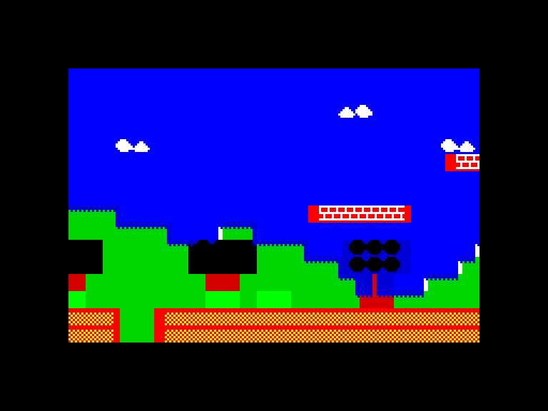

# Parallax spike: banded, 2-layer, 3-layer and retained-background scrolling on the V2 pre-shifted tables (2026-11-09)

Extends `../RESULTS.md` (V2 = pre-shifted tile tables, 35 T per byte). Question: what does parallax cost on top of V2, which
layering is affordable at 15 and 20 fps for a platformer with a 16x24-pixel player, and what art rules does the
one-colour-pair-per-cell limit impose?

Method as the parent: TSRun, stock TS2068 RAM, `DI`, routine entered by `CALL`, T-states exact (`m.tstates`, `CALL` to final
`RET`, both included, **no contention modelled**, 58,688 T per refresh). Z80 built with sjasmplus; a JS reference compositor
(`plib.mjs`: `refCompose`, `refBanded`) renders every frame independently. **Every run compares all 6,144 bitmap bytes and all 768
attribute cells with the reference at 50 camera positions (48 spread over the map with a varying 1/256-pixel fraction, plus both
ends; the P4 runs compare 64 consecutive ticks). 51 variant runs, 0 mismatches** (`all-output.txt`). Tables are the ROM-resident data
(built in JS and poked: a compiler would emit them into the cartridge ROM); building them at boot is not measured.

Reproduce: `node run-parallax.mjs` (all, ~20 s, writes `results.json`; or `p1 p2 p2o p2f p2s p3 p3f p4`), `node fits.mjs`,
`node shot.mjs` (the PNG). Needs `/usr/local/bin/sjasmplus`. Files: `par.inc` (map and shared macros), `p1.asm`, `lay.asm`
(P2, P3, P4 by defines), `attr.inc`, `plib.mjs`, `run-parallax.mjs`, `fits.mjs`, `shot.mjs`, `p3-frame.png`.

## Headline (24x16 window = 384 cells; T-states; "attr" = the attribute passes of a tick that crosses a cell boundary)

| Variant | Bitmap mean / worst | Attr (worst) | Worst tick | Fits in refreshes | Code | Tables (ROM) |
|---|---:|---:|---:|---|---:|---|
| V2 single layer (parent, 24x16) | 109,007 / 113,388 | 15,225 | 128,613 | 3 | 2,488 B | 4,096 B |
| **P1 banded** 2+4+6+4 rows, speeds 1/4, 1/2, 1, 2 | 109,299 / 114,220 | 15,888 | 130,108 | 3 | 2,720 B | 4,096 B (one shared tile set) |
| P1 + blank-cell path, 85 % blank map | 76,693 / 82,569 | 15,888 | 98,457 | 2 | 3,824 B | 4,096 B |
| **P2 two layers**, fg covers 0 % of cells | 129,181 / 129,181 | 33,972 | 163,153 | 3 | 2,951 B | 12,288 B |
| P2, fg 5 % of cells (semi-transparent) | 142,640 / 148,809 | 34,014 | 182,823 | 4 | 2,951 B | 12,288 B |
| P2, fg 20 % | 183,171 / 184,575 | 34,247 | 218,822 | 4 | 2,951 B | 12,288 B |
| P2, fg 50 % | 263,773 / 263,773 | 39,019 | 302,792 | 6 | 2,951 B | 12,288 B |
| P2, fg 100 % | 398,365 / 398,365 | 46,267 | 444,632 | 8 | 2,951 B | 12,288 B |
| P2 + opaque path, 20 % (half the runs opaque) | 176,017 / 178,633 | 34,247 | 212,880 | 4 | 3,141 B | 12,288 B |
| P2 + opaque path, 100 % all opaque tiles | 235,549 / 235,549 | 46,267 | 281,816 | 5 | 3,141 B | 12,288 B |
| **P3 three layers**, mid 0 % fg 0 % | 146,134 / 146,134 | 52,719 | 198,853 | 4 | 5,336 B | 20,480 B |
| P3 mid 10 % fg 10 % | 200,449 / 203,498 | 52,843 | 256,341 | 5 | 5,336 B | 20,480 B |
| P3 mid 30 % fg 30 % | 316,532 / 324,194 | 56,689 | 380,883 | 7 | 5,336 B | 20,480 B |

Full-screen 32x24 (768 cells; only where it was built; windows are centred, map stride 128, camera range limited as in the parent):

| Variant | Bitmap mean / worst | Attr (worst) | Worst tick | Fits in refreshes | Code |
|---|---:|---:|---:|---|---:|
| P1 banded 3+6+9+6 rows | 216,006 / 225,798 | 29,752 | 255,550 | 5 | 3,468 B |
| P1 banded + blank path | 152,891 / 159,728 | 29,752 | 189,480 | 4 | 4,940 B |
| P2 fg 0 % / 5 % / 20 % / 50 % / 100 % | 255,887 / 282,834 / 363,589 / 525,071 / 794,255 | 65,156 .. 89,739 | 321,043 .. 883,994 | 6 / 6 / 8 / 11 / 16 | 3,711 B |
| P3 mid/fg 0/0, 10/10, 30/30 | 289,472 / 398,029 / 630,211 | 101,223 .. 108,940 | 390,695 / 504,703 / 760,672 | 7 / 9 / 13 | 6,760 B |

None of the transparent-layer variants fits a full 32x24 screen in 4 refreshes (15 fps). Only P1 with open sky does (189k).
Smaller windows with a transparent layer (measured): P2 20x14 at 5 % / 20 %: 104,669 / 134,167 bitmap, worst tick 136,653 / 159,876;
P2 16x12 at 5 % / 20 %: 72,619 / 92,879 bitmap, worst tick 92,641 / 113,896; P3 20x14 mid 10 % fg 10 %: 146,830 (worst tick 191,907);
P3 16x12 mid 10 % fg 10 %: 101,715 (worst tick 135,409).

Cell density is defined as **the fraction of window cells that contain pixels of the layer** (the pair rule below), by construction of
the test maps (`mapRuns`: runs of 3 tiles every P cells, row-staggered, so every window sees the same count). It is not the fraction of
non-blank tiles: with a pixel phase other than 0 a tile touches two cells, so a 3-tile run contains pixels in 4 cells. The measured
cover is printed per run (`cover mid / fg`). The semi-transparent tiles are the worst case for cost: random masks, nothing opaque.

Per cell, 24x16, means: plain V2 table cell 295 T all-in (113,388 / 384); **blank-fg cell in the 2-layer renderer 336 T** (+41:
dispatch); **semi-transparent fg cell 1,037 T (+701, 130 T per byte)**; **opaque fg cell 613 T (+277)**. A middle-layer cell costs
the same as a foreground cell (+692 measured); a cell with both layers costs the two plus about 280 T.

## Conventions shared by all variants

* World maps 128 cells wide (stride 128, so a row never crosses a page), one byte per cell = tile*8 (32 tiles per layer). Tile 0 of
  the far layer is a blank opaque tile; tile 0 of a transparent layer is fully transparent. Tiles 16..31 of a transparent layer are
  opaque in the tests (map byte >= 128: that is what the opaque fast path tests).
* A layer's pixel position is `floor(camera * ratio)`; `col0 = pos >> 3`, `phase = pos & 7`. **The camera is 16.8 fixed point (24
  bits)**, not 8.8: 8 integer bits cover only 256 pixels of a 1,024-pixel world. Ratio 2 uses bit 7 of the fraction, 1, 1/2 and 1/4 are
  integer shifts (floor of the 16.8 value, identical to the integer floor for these ratios). P4's far layer accumulates `pos += 0x0040`
  (0.25 px) per tick in 16.8 (`far_advance`).
* Byte of a layer at screen cell c = `(T[m[c]+r] << p | T[m[c+1]+r] >> (8-p)) & $FF` as V2.
* **Attribute rule.** Far layer: attribute of tile `m[c]` (V2 convention). A transparent layer *owns the colour of a cell that contains
  its pixels*: `m[c] <> 0`, or phase <> 0 and `m[c+1] <> 0`; the attribute is that of `m[c]`, else that of `m[c+1]` (so a tile gets
  its own colour as soon as its first pixel enters the cell on its left, instead of its leading pixels being drawn in the neighbouring
  tile's colours). The top layer that owns the cell wins; attribute 0 is reserved for "no pixels" in the transparent layers' attribute
  tables (art rule). The literal "m[c] only" rule would be cheaper but draws the first `phase` pixels of every tile in the colours
  of the cell to its left.
* "Attr" below is the cost of the attribute passes when a cell boundary was crossed (as the parent: bitmap worst + attr = worst tick).
  Both display files must be correct, so the pass is needed on the tick a layer's `col0` changed and, for the hidden file, on the next.

## P1: banded parallax (`p1.asm`)

The window is split into bands of whole cell rows (2+4+6+4 for 24x16, 3+6+9+6 for 32x24); every band is V2 (the same loops, the
phase-0 copy path included, the same 4 KB of tables) at its own pixel position, reading its own rows of the 128-wide map. Per band:
`LPOS` (camera x ratio), phase, `col0`, map pointer, row count, then the V2 row loop. The "per-row offset lookup" is therefore a
**per-band setup of about 240 T** (a per-row table, for arbitrary per-row speeds, is not built; it would add the same setup per row,
roughly 16 rows x 40 T, estimate). Attributes: `attr_rows` per band with the band's own `col0`.

| Control, same cameras (50) | Bitmap mean / worst | Attr |
|---|---:|---:|
| 24x16 as ONE band at ratio 1 (= V2) | 108,509 / 113,417 | 15,271 |
| 24x16 four bands, all ratio 1 | 109,219 / 114,140 | 15,808 |
| 24x16 four bands 1/4, 1/2, 1, 2 | 109,299 / 114,220 | 15,888 |

So **P1 costs V2 plus 237 T per extra band (+0.65 % for four bands) and 179 T per band in the attribute pass**; the speeds do not
matter (the mean differs by phase luck only). 32x16: 144,358 / 150,892; blank-cell path on a mostly open map as in the parent
(76,693 vs 109,299, 24x16). Table RAM 4,096 B for all bands together (one tile set; the tile table of 256 B for the phase-0 copy
path and the 256-B attribute table are extra), maps 2 KB (128 x 16). The far layers of a platformer can be P1 bands at nearly no
cost.

## P2: two true layers (`lay.asm`, `NL=2`)

Background map (opaque, V2 tables) + foreground map with transparency. Per byte of a cell that has fg pixels:
`out = (bg_shifted AND keep_shifted) OR ink_shifted`, the tables per fg phase being four pages
`[ink L, keep L, ink R, keep R]` (ink and keep adjacent so one `inc h` / `dec h` switches between them; keep tables are shifted with
ones shifted in, `KL = (K << p) | (2^p - 1)`, `KR = (K >> (8-p)) | (255 << p)`, so `keep_shifted = KL AND KR` and
`ink_shifted = IL OR IR`): **6 table reads per byte, 101 T per byte** by instruction count in the chain below (the measured whole cell is 1,037 T with wrapper and call).

* **Dispatch with a blank-cell fast path.** The fg map pointer walks in `HL'` (one `inc l` per cell); per cell
  `exx / ld a,(hl) / inc l / or (hl) / exx / jr z,fast` = 38 T tests `m[c] | m[c+1]`. A blank pair is drawn **exactly as V2** (the
  same unrolled `ROWS_UP/ROWS_DN` code, same far pointers, same boustrophedon); the pair rule is needed because a tile in `m[c+1]`
  puts pixels into cell c whenever the phase is not 0. Cost over V2 for a blank cell: +41 T (336 against 295 T).
* **Slow cell** (`slow_up`/`slow_dn`, called through `fg_slow_up/dn`, which save `HL'`, load the two ink pointers from the pair and
  restore): per byte `ld a,(de) / or (hl) / inc l / inc e` (far byte), `exx`, then
  `inc h / and (hl) / ex de,hl / inc h / and (hl) / dec h / or (hl) / ex de,hl / dec h / or (hl)` (merge, 52 T), `inc l / inc e / exx`,
  `ld (bc),a / inc b`. The whole cell is 792 T plus about 145 T of wrapper and call. **A cell drawn downwards starts at row 7, so its
  overlay pointers need `or 7` as the far ones do** (bug found by the first verification: every odd, downward fg cell was wrong).
* **Opaque fast path (`-DOPAQUE`).** A fg cell whose two tiles are both opaque (map byte >= 128: tiles 16..31) is the fg ink alone
  (keep = 0): `opq_up/dn`, 41 T per byte, no far reads; the far pointers are advanced by 7 to keep V2's state. Cost 613 T per cell
  instead of 1,037. The test is `and` of the two bytes, sign flag, inside the slow wrapper, so a semi-transparent cell pays about +6
  T and the whole path costs +0.8 % at 20 % semi-transparent cells (184,557 vs 183,171).
* **Attributes:** far pass (`attr_rows`: 15,086 T for 24x16, as V2) plus one overlay pass over all cells (`attr_ov_pn`, phase <> 0:
  34 T per blank pair, roughly 75 to 100 T per cell with pixels (estimate); `attr_ov_p0`): 31-47 k in total. If **only the far layer owns the colour** (the
  fg inherits each cell's colours) the attribute pass is the far pass alone: 15,086 T.

| fg cells with pixels | Bitmap mean / worst | Attr mean / worst | with OPAQUE path, half the runs opaque | all tiles opaque (OPAQUE path / without) |
|---|---:|---:|---:|---:|
| 0 % | 129,181 / 129,181 | 31,336 / 33,972 | | |
| 5 % | 142,640 / 148,809 | 32,039 / 34,014 | 140,775 / 146,661 | |
| 20 % | 183,171 / 184,575 | 34,149 / 34,247 | 176,017 / 178,633 | |
| 50 % | 263,773 / 263,773 | 38,353 / 39,019 | 245,783 / 251,759 | |
| 100 % | 398,365 / 398,365 | 44,653 / 46,267 | 361,378 / 373,453 | 235,549 / 398,365 |

At 100 % with half the cells opaque only a quarter of the cells have an opaque pair, hence the small gain in that column; with
platforms and ground as long runs, the edge cells (two per run) are the only semi-transparent ones.

## P3: three layers (`lay.asm`, `NL=3`)

Far (1/4), middle (1/2), foreground (1). Per cell, two pair tests (the middle map is walked through `IY`, 38 T; the fg through `HL'`,
26 T), four cases: none = V2 fast path; mid only, fg only = the P2 slow cell with that layer's pointers; **both = the chain with the
middle layer (far + mid to the screen), then the foreground merged in place onto the 8 screen bytes** (`inpl_up/dn`, 78 T per byte;
the cell's pixel row is put back with `ld a,b / sub 7 / ld b,a` first). Only two of the three pointer pairs fit the registers
(`HL DE` main, `HL' DE'` alt, `BC` the screen), hence the in-place second pass; a cell with both layers costs the two slow cells
plus about 280 T. The empty three-layer renderer already costs 146,134 (the dispatch: 41 T + 38 T per cell over V2).

| mid \ fg cells | 0 % | 10 % | 30 % |
|---|---:|---:|---:|
| 0 % | 146,134 / 146,134 | 173,286 / 175,816 | 229,640 / 230,854 |
| 10 % | 172,717 / 175,262 | 200,449 / 203,498 | 257,825 / 263,325 |
| 30 % | 227,964 / 229,294 | 256,659 / 262,471 | 316,532 / 324,194 |

(bitmap mean / worst). Attributes (two overlay passes): 47,509 mean at 0/0 up to 56,689 worst at 30/30; far-only 15,086.
Code 5,336 B (24 columns x two cells x four paths), tables 20,480 B in ROM address space (far 4 KB + two masked layers 8 KB each;
with 16 tiles per masked layer half of every page is unused: 10 KB of real data), three maps 6 KB, three 256-B attribute tables.
A compact layout (ink and keep in the two halves of a page, `set 7,l` / `res 7,l` instead of `inc h` / `dec h`) would halve the
masked tables to 4 KB each at about +16 T per byte; not built.

## P4: a stateful slow background (`lay.asm`, `-DP4`, `-DRETAINED`)

Far layer moving by itself, 1 pixel per 4 ticks, plus a fg overlay at the camera speed; 64 consecutive ticks, 16 far steps, each
tick compared with the reference. Far layer = a retained buffer (one 256-byte page per window row, cells 8 bytes in cell-major
order: 4,096 B address space, 3,072 B used for 24x16). From the buffer a blank-fg cell is a plain copy (22 T per byte, 236 T per
cell all in against 336, measured as the copy-only tick) and a merge reads `ld a,(hl)` for the far byte (91 T instead of 101 per byte).

* **a** recompose every tick (the P2 renderer, far position from `FARPOS`).
* **b** one buffer: on the tick the far position changes (every 4th) rebuild all 16 rows (`rebuild`: V2's loops writing the buffer,
  +8 T per cell for the pointer fix-up) and compose.
* **c** two buffers: every tick rebuild four rows of the *next* image (far position + 1; the layer's motion is predictable), swap
  at the tick it is needed, so the worst tick is the average tick. Costs a second buffer and **needs a predictable layer**
  (auto-scroll, clouds); a camera-driven layer cannot be sliced ahead.

| fg cells | a: mean = worst | b: mean / worst (copy-only tick, rebuild tick) | c: mean / worst |
|---|---:|---:|---:|
| 0 % | 129,309 | 119,883 / 207,297 (90,745; 207,297) | 120,363 / 120,524 |
| 5 % | 140,529 / 141,927 | 131,103 / 219,915 (101,965; 218,517) | 131,583 / 133,142 |
| 20 % | 183,640 / 184,703 | 174,214 / 262,691 (145,076; 261,628) | 174,694 / 175,918 |

The rebuild costs 116,552 T (V2's 24x16 + the buffer fix-up) and the retained copy saves 38.6 k per tick, so the break-even is a far
layer that changes **every 3 ticks**: at N = 4 the average saving is only 9.4 k (7 %) and (b) loses on the worst tick (+78 k); (c) is
the only useful form. Average tick as a function of N (ticks per far step, 0 % fg): N=2: 149,021 (worse than recomposing),
4: 119,883, 8: 105,314, 16: 98,030, 32: 94,387 (against 129,309). Gain at 1 pixel per 8 ticks: 19 %; per 16: 24 %; asymptote 30 %. Not
worth a second 3 KB buffer for a layer that moves a pixel every 4 ticks; worth it only for layers that are nearly static.
Code 4,032 B (rebuild and the three tick drivers included) against 2,973 B.

## Fits (`fits-output.txt`; 1, 2, 3, 4 refreshes = 58,688 T each, worst tick = bitmap worst + attribute worst)

Sprites: the spike's 5.2k T per sprite for erase + draw (6 sprites 31,200, 16 sprites 83,200); where the background is repainted
anyway no erase is needed and the draw alone is taken as 3.5k (about two thirds, from runtime v2's split of 33.5k erase in 105.9k
for 16 sprites; derived, not measured here). The player (16x24 = 3x4 cells) is about 1.5 sprites of that size. Game logic is not
included: leave 10 to 25k. Min refreshes (fps = 60.11 / n):

| Variant (24x16 unless stated) | Worst tick | Alone | 6 sprites 5.2k | 16 sprites 5.2k | 6 no erase | 16 no erase |
|---|---:|---|---|---|---|---|
| V2 single layer | 128,613 | 3 (20) | 3 (20) | 4 (15) | 3 (20) | 4 (15) |
| **P1 banded** | 130,108 | 3 (20) | 3 (20) | 4 (15) | 3 (20) | 4 (15) |
| P1 banded + blank path | 98,457 | 2 (30) | 3 (20) | 4 (15) | 3 (20) | 3 (20) |
| P2 fg 0 % | 163,153 | 3 (20) | 4 (15) | 5 (12) | 4 (15) | 4 (15) |
| P2 fg 5 % | 182,823 | 4 (15) | 4 (15) | 5 (12) | 4 (15) | 5 (12) |
| P2 fg 20 % | 218,822 | 4 (15) | 5 (12) | 6 (10) | 5 (12) | 5 (12) |
| P2 fg 20 %, OPAQUE path, half opaque | 212,880 | 4 (15) | 5 (12) | 6 (10) | 4 (15) | 5 (12) |
| P2 fg 50 % | 302,792 | 6 (10) | 6 (10) | 7 (9) | 6 (10) | 7 (9) |
| P2 20x14 fg 5 % / 20 % | 136,653 / 159,876 | 3 (20) | 3 / 4 | 4 / 5 | 3 / 4 | 4 / 4 |
| P2 16x12 fg 5 % / 20 % | 92,641 / 113,896 | 2 (30) | 3 (20) | 3 / 4 | 2 / 3 | 3 / 3 |
| P3 mid 0 % fg 0 % | 198,853 | 4 (15) | 4 (15) | 5 (12) | 4 (15) | 5 (12) |
| P3 mid 10 % fg 10 % | 256,341 | 5 (12) | 5 (12) | 6 (10) | 5 (12) | 6 (10) |
| P3 mid 30 % fg 30 % | 380,883 | 7 (9) | 8 (8) | 8 (8) | 7 (9) | 8 (8) |
| P3 20x14 mid 10 % fg 10 % | 191,907 | 4 (15) | 4 (15) | 5 (12) | 4 (15) | 5 (12) |
| P3 16x12 mid 10 % fg 10 % | 135,409 | 3 (20) | 3 (20) | 4 (15) | 3 (20) | 4 (15) |
| P4c fg 5 % (retained, sliced) | 167,124 | 3 (20) | 4 (15) | 5 (12) | 4 (15) | 4 (15) |

With **far-only attributes** (15,086 T instead of 34-53 k; the rule "transparent layers inherit the cell's colours"):

| Variant | Worst tick | Alone | 6 sprites no erase (21,000) | 16 sprites no erase (56,000) |
|---|---:|---|---|---|
| P2 fg 0 % | 144,267 | 3 (20) | 3 (20) | 4 (15) |
| P2 fg 5 % | 163,895 | 3 (20) | 4 (15) | 4 (15) |
| P2 fg 20 % | 199,661 | 4 (15) | 4 (15) | 5 (12) |
| P2 20x14 fg 20 % | 145,523 | 3 (20) | 3 (20) | 4 (15) |
| P3 mid 0 % fg 10 % | 190,902 | 4 (15) | 4 (15) | 5 (12) |
| P3 mid 10 % fg 10 % | 218,584 | 4 (15) | 5 (12) | 5 (12) |
| P3 20x14 mid 10 % fg 10 % | 163,520 | 3 (20) | 4 (15) | 4 (15) |

### What the sprite pass needs when the background is repainted every tick

The engine's sprite erase redraws the cells a sprite covered from the cell map (up to 3x3 cells per sprite). A parallax renderer
**replaces that**: it repaints the whole window from the layer maps every tick, on both display files, so what a sprite drew two ticks
ago is gone and **sprites inside the window are drawn after the repaint and the attribute pass with no erase and no per-sprite
background bookkeeping** (saves about a third of a sprite's cost). The erase pass stays only for sprites on the static part of the
screen outside the window (HUD, border art). One catch: sprite cells carry the sprite's attribute; because the attribute passes run
only on cell-step ticks, a cell that a sprite coloured in the hidden file is not repainted by the next bitmap pass. Either the
sprite draws without writing attributes (mono sprites, taking the cell's colours: nothing to restore), or its old cells' attributes
are recomputed from the layers (about 12 to 20 cells, estimated 1.2 to 2 k T per sprite, not built), or the attribute pass runs every
tick (15.1 k far-only, 34 k with one overlay).

## Recommendation: which layering is affordable (platformer, 16x24 player, about 6 sprites, 15 k of game logic)

Budgets: 20 fps = 3 refreshes = 176,064 T, 15 fps = 4 refreshes = 234,752 T. After 15 k of logic and 6 sprites without erase (21 k)
the world, attributes included, gets about **140 k at 20 fps** and **198 k at 15 fps**.

* **20 fps: banded parallax only, 24x16 (P1)**: 130 k worst tick, 4 bands at any speeds for the price of V2 (+0.24 k per band); with logic and 6 sprites without erase it is
  about 166 k, so it fits; 98 k with open sky (the blank-cell path, at no extra table RAM) takes 10 sprites. A true transparent layer does not fit 24x16 at 20
  fps in this implementation (P2 with an empty layer is already 144 k with far-only attributes, 163 k with full attributes, because
  the dispatch costs 41 T per cell). If an overlay is wanted at 20 fps: window 20x14 with an overlay up to 20 % of cells and
  far-only attributes (145 k, marginal), 16x12 with full attributes (114 k at 20 %), or 20x14 with 5 % (137 k, marginal).
  Three transparent layers (P3) at 20 fps only in 16x12 (135 k).
* **15 fps: banded far/mid parallax (P1, opaque tiles) plus at most one transparent foreground layer (P2)**. Cost of the combination =
  P2 plus 0.24 k per extra band (the band setup is independent of the overlay; **the combination itself was not built**, this is an
  estimate). P2 24x16 fits 6 sprites at 5 % of cells with full attributes (183 k) and at about 10-15 % with far-only attributes
  (164 k at 5 %, 200 k at 20 %: marginal). Opaque platforms and ground are cheap (+277 T per cell, 20 % of the cells opaque
  plus 5 % semi-transparent is about 165 k bitmap): put the solid level geometry in opaque tiles and use semi-transparent cells for
  decoration only. 16 sprites at 15 fps leave room for P1 only (P2 at 5 % with far-only attributes and no erase is marginal: 220 k + logic).
* **Do not offer three transparent layers as a general mechanism** (146 k empty at 24x16; 200-256 k with 10 % overlays; 20 KB of
  table ROM; the attribute passes alone 53 k). Make far and mid layers P1 bands (or one opaque layer with bands), and keep one
  transparent layer, the gameplay one.
* **The retained buffer (P4) does not pay for 1 px per 4 ticks** (7 % on average); only the sliced form is usable (worst = average) and only
  for layers that change every 8 ticks or less often (20 to 30 %). Skip it for the platformer.
* **Where the time goes** (and what is not done): the attribute passes are 20-30 % of the worst tick of a layered frame; a
  pre-expanded far attribute map in ROM with `LDI` rows would take the far pass from 15.1 k to about 8 k; a per-row "layer is
  empty" table would skip the dispatch (41 T per cell) and the overlay pass in blank rows (a level's mid layer typically occupies a few rows);
  a pair-combined (keep, ink) cache for repeated tile pairs (ground) could bring the semi-transparent cell from 130 T per byte to about
  65 T. None of these is built or measured.

## Art rules that follow from one colour pair per 8x8 cell

(The screenshot, `p3-frame.png`, is a real frame of the Z80 renderer, three layers at camera 203.5 px, positions 50 / 101 / 203,
phases 2 / 5 / 3, checked against the reference. Look at the dark blocks where trees overlap hills.)

1. A cell holds two colours, ink and paper, whatever is composited into it. **A cell that contains any pixel of a transparent layer
   takes that layer's attribute**, so everything behind it in that cell (far-layer ink and paper) is redrawn in the overlay's ink
   and paper. In the screenshot the trees (black ink on blue paper) turn the green hills behind them black.
2. So **an overlay tile's paper must be the paper colour of whatever it overlaps** (the sky colour, one paper colour for the far layer
   per row band, or the same paper everywhere), and its ink is the only colour the overlay can show; far-layer detail inside an
   overlay cell appears in the overlay's ink. Make the far layer's detail rows and the overlay's rows not overlap, or accept the
   recolouring.
3. The colour changes in 8-pixel steps while pixels move per pixel: in a horizontal run of fg tiles the cell takes the colour of the
   left tile first (a cell's attribute is that of `m[c]`, else `m[c+1]`), so **adjacent fg tiles in a run share one attribute** and
   runs of different colour are separated by a blank cell; a tile's first (phase) pixels are otherwise drawn in its left neighbour's
   colours.
4. **Attribute 0 is "this layer has nothing here"**: overlay tiles never use black-on-black (use ink 1 to 7, any paper, bright
   or flash). Tile 0 is the transparent tile.
5. **Opaque tiles are cheap, semi-transparent ones are 3x dearer than a plain cell**: sort tiles so that opaque ones (ground,
   platforms, walls) have map bytes >= 128 (tiles 16..31), keep runs of them long (only the edge cells of a run cost the
   transparent price), and use transparent tiles only for decoration and edges. At most 16 transparent and 16 opaque tiles per layer
   with the one-byte map (tile*8).
6. The player and enemies bring their own attribute (3x4 cells for 16x24): their cells replace the world's colours in the cells they
   cover; give them the sky paper or draw them mono with the world's colours.
7. All bands of a P1 layer share one tile set and one set of tables, so extra bands are free in table RAM: design the bands' art
   with one paper colour per band (cell rows), ink variation inside.
8. Keep each overlay layer within few cell rows where possible (a row table can then skip blank rows) and sparse: budget each
   transparent cell as about 1,000 T and each opaque cell as about 600 T against 336 for an empty one.

## Techniques and traps (what bit me)

* **Pair rule.** A tile at phase <> 0 touches two cells, so "5 % of tiles" is about 10 % of cells in the slow path for scattered tiles.
  The fast-path test must be on the pair `m[c] | m[c+1]`, not on `m[c]`, or tile pixels entering a cell from the right are lost.
* **Downward cells start at row 7** for every pointer pair, including the overlay ones (the first run had every odd fg cell wrong).
  A slow cell must leave the far pointers exactly where V2's fast cell leaves them (`l = idx + 7`, `e = idx + 7`; the opaque path
  adds 7 itself), and the screen pointer 7 rows down; the boustrophedon then continues unchanged.
* **Registers.** Three pointer pairs plus the screen pointer do not fit in six pointer registers: P2 uses far on the main pair and
  overlay on `HL' DE'`; the foreground map pointer therefore lives in `HL'` and must be pushed around every slow call (`exx / push hl`
  ... `pop hl / exx`); P3 composes the middle layer in the chain and the foreground in place on the screen. **`exx` does not touch
  flags** (the `jr z` after the pair test is valid), but the frame interrupt handler must preserve `HL' DE' BC' AF'`, `IX` and `IY`
  if it uses them, as in the parent.
* **Instruction limits.** `and`/`or` with a memory operand exist only for `(HL)`, hence `ex de,hl` and the page toggles; `ld a,(de)`
  is the only other table read, so the merge keeps ink and keep in adjacent pages (`inc h`). `jr` cannot span a 24-column unrolled
  row or the P3 slow sites (`jp` for the slow-case jumps).
* **sjasmplus:** numeric labels (`1:` / `3F`) inside macros expanded by `DUP` work; a `K DEFL` counter used as a macro argument
  expands textually (`(iy+K*2+1)`); `IFDEF` tests only `DEFINE`s / `-D`, so addresses that the harness must know are given with
  `-D` and not as `EQU`; `ASSERT $ < $A000` guards the code area against the table area.
* **Memory map of the test machine** (all RAM): screen `$4000`, tile / attribute tables `$5B00-$5EFF`, variables `$5F00`, fg tables
  `$6000-$7FFF`, code `$8000-$9FFF`, mid tables `$A000-$BFFF` (the P4 buffers use this area when there is no mid layer), far tables
  `$C000`, maps `$D000...`. On a real cartridge the 12 to 20 KB of tables are ROM: 4 KB (V2) of the 32 KB budget becomes 12 KB for P2
  and 20 KB for P3.
* **Phase 0** goes through the tables in P2 and P3 (right tables are zero / ones), so there is no phase-0 shortcut; the worst tick
  of a layered frame is the typical tick. P1 keeps V2's copy path (its best case, every band at phase 0, is 30 % below its worst).
* **Not modelled:** contention on `$4000-$7FFF` (every write to the display files), interrupts (these runs are `DI`), real hardware.
