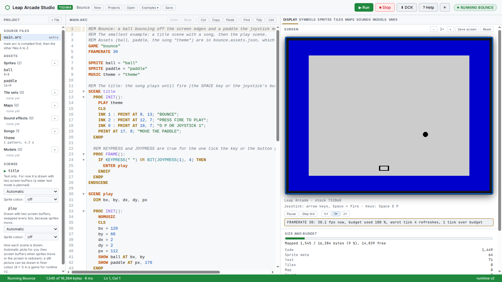

# Getting started with Leap Arcade

**With screenshots and playable examples: <https://nchiker.github.io/2068-Leap-IDE/arcade.html>.** This file is the same guide as plain text.



Leap Arcade is a language for writing action games for the Timex Sinclair 2068 (TS2068). You write a small
structured-BASIC program, draw sprites, tiles and sounds in the **Leap Arcade Studio**, and press Run. The Studio
compiles the game to native Z80 code and runs it in the built-in TS2068 emulator. When you are happy, **⬇ DCK**
saves a cartridge file that runs on a stock TS2068 (or in any emulator that loads `.dck` files).

This guide takes you from opening the Studio to a finished small game. It is a tutorial. The exact rules of each word
are in [`ARCADE_LANGUAGE.md`](ARCADE_LANGUAGE.md) and in the Studio's own Help (F1).

> Everything here has been tested in emulators only (TSRun, ZEsarUX, Fuse). Real TS2068 hardware is untried.

## 1. Open the Studio

The Studio is a web page with no build step. It needs only a static file server (ES modules do not load from `file://`):

```
git clone --recurse-submodules https://github.com/nchiker/2068-Leap-IDE.git
cd 2068-Leap-IDE
python3 -m http.server 8080
```

Open <http://localhost:8080/studio.html>. (The published copy is at
<https://nchiker.github.io/2068-Leap-IDE/studio.html>.) Leap Arcade Studio is a separate page from the Leap IDE
(`ide.html`), which is for Leap V2 BASIC, Leap-Forth and Leap-C.

## 2. A tour of the screen

| Area | What it does |
|---|---|
| **Toolbar** | New, Projects, Open, Examples ▾, Save, ▶ Run (F5), ■ Stop (F6), ⬇ DCK, ? Help (F1), light / dark theme |
| **Left: project panel** | **Source files** (`main.arc` is the entry; **+ File** adds more), **Assets** (Sprites, Tile sets, Maps, Sound effects, Songs, Models, each with a **+** to add one) and **Scenes** (one row per scene: how it is drawn, and a *Sprite colour* choice) |
| **Middle: code editor** | highlighting, completion, hover help, error marks. Keywords are upper-cased as you type. Buttons: Undo, Redo, Cut, Copy, Paste, Find, Tidy, Lint |
| **Right: tabs** | **Display** (the TS2068 screen, Zoom, Reset, Save screen, Pause, Step tick, and the *size table* showing how much memory the game uses), **Symbols**, **Sprites**, **Tiles**, **Maps**, **Sounds**, **Models**, **Vars** (the game's variables, live) |

The Studio compiles your project about 400 ms after you stop typing. The first problem is marked in the editor, so
you see errors before you press Run. **Lint** shows the first message in the status bar.

Your project is saved automatically in the browser. To keep it, press **Save**: that writes a `.leapgame` file (one
JSON file holding the source and every asset). **Open** loads a `.leapgame` file. **Projects** lists the projects
kept in this browser.

## 3. Try an example first

Open **Examples ▾** and pick **Bounce**. Press **▶ Run** (F5). The title screen appears. Click the emulator screen to give it the keyboard:

- **SPACE** (or the joystick's fire button) starts the game from the title.
- **O** and **P** move the paddle left and right. The arrow keys and Space also act as joystick 1.

The examples worth reading, roughly from simplest to most advanced:

| Example | Shows |
|---|---|
| Bounce | the smallest complete game: a title scene with a song, then a play scene |
| Breakout | bricks as tiles, collision with `HIT`, sound effects, score, lives |
| Blockfall | a falling-block puzzle |
| Starfall (fine colour), Shooter (classic) | a vertical shooter with pools of sprites, three scenes and songs |
| Leap Runner (platformer, 4 levels) | a scrolling platformer (`WINDOW`, tile collision) |
| Crabsmash, LUMEN | fine colour (an 8 x 1 colour grid, instead of the usual 8 x 8) |
| Vaults | a first-person ray-cast maze |
| Orbit Gates | wireframe 3D |

## 4. Start a new game

Press **New**. Every new project starts from a *starter*: a small, complete game with its own sprites and sounds and
comments that say what to change. The dialog shows a picture of each:

| Starter | Runtime | What it teaches |
|---|---|---|
| Blank game ("Star Dash") | v2 | the smallest game that still has a point: steer a ball, catch stars against a clock |
| Sprites and tiles | v2 | gems in a tiled mine, pooled bats, sound, score |
| Scenes and music | v2 | title, play and game-over scenes, a song, a session best score |
| Fine colour | v2 | 8 x 1 colour scenes with row-by-row shaded art |
| Coin Hop | v3 | a scrolling platformer (`WINDOW`, `SOLID`, `CAMERA`) |
| Gem Maze | v4 | a first-person maze (`VIEW3D`) |
| Ring Run | v2 | wireframe 3D (`WIRE3D`, `MODEL`, `EYE`) |

Pick **Blank game** for a first game and press **Run**. Use **O P Q A** (or the arrow keys, which act as joystick 1) to
steer the ball onto the star. The comment at the top lists what to change first. Try these:

- Change `CONST SPEED = 3` to `5` and run again: the ball moves faster.
- Change `clock = 300` in `NEWGAME` (30 ticks a second, so 300 is 10 seconds) to `150`.
- Change the `"*"` in `NEWSTAR` to another character.

The program is organised as the next section describes.

## 5. The shape of a program

Leap Arcade keeps the look of Leap V2 BASIC (no line numbers, `IF` … `ENDIF`, `PROC` … `ENDP`, `REM` comments), but
a game is organised around **scenes** and a runtime that owns the main loop.

```
GAME "My game"        REM the title, once, at the top
FRAMERATE 30          REM FRAME runs 30 times a second (60, 30, 20, 15, 12, 10 ...)

SPRITE ball = "ball"  REM declare the assets the game uses, by name

SCENE play            REM a part of the game
  DIM x, y            REM variables of this scene

  PROC INIT():        REM runs once when the scene starts
  ENDP

  PROC FRAME():       REM runs every tick; you do the logic, the runtime does display, sync and sound
  ENDP
ENDSCENE
```

Points to remember:

- **You never write the main loop.** The runtime calls your `FRAME` once per tick, draws what you changed
  (sprites, text, tiles) and keeps the sound going.
- **Scenes** are the parts of a game (title, play, game over). The first scene starts the game. `ENTER name` switches
  to another scene and does not return: the scene's `INIT` runs, then its `FRAME` from the next tick. Variables
  declared inside a scene belong to that scene; variables declared at the top level survive a scene switch.
- **No `GOTO`, no labels, no `GOSUB`.** Use `IF`, `FOR`, `WHILE`, `PROC`/`CALL` and scenes.
- **Numbers are 16-bit integers.** There are no floats and no string variables. Text is only printed
  (`PRINT "SCORE "; score`). To move slower than one pixel a tick, scale your positions (for example keep them in
  1/8 pixels and divide when you `SHOW`).
- **The screen is 256 x 192 pixels, y counts from the top.** Text is 32 columns x 24 rows (`PRINT AT row, col; ...`).
- Names are letters and digits (no underscore), case-insensitive. Asset names live apart from variable names.

## 6. Walking through Bounce

`arcade/examples/bounce.arc` is the whole game in about 100 lines. The parts:

**Declarations**

```
GAME "bounce"
FRAMERATE 30
SPRITE ball = "ball"
SPRITE paddle = "paddle"
MUSIC theme = "theme"
```

The quoted strings are asset names: `SPRITE ball = "ball"` looks up the sprite called `ball` in the project's assets.

**A title scene**

```
SCENE title
  PROC INIT():
    PLAY theme
    CLS
    INK 1 : PRINT AT 8, 13; "BOUNCE";
  ENDP

  PROC FRAME():
    IF KEYPRESS(" ") OR BIT(JOYPRESS(1), 4) THEN
      ENTER play
    ENDIF
  ENDP
ENDSCENE
```

`PLAY theme` starts the song. `KEYPRESS(" ")` is true for the one tick the key goes down (use `KEYDOWN` for "is held").
`JOYPRESS(1)` and `STICK(1)` give the joystick as bits: 0 up, 1 down, 2 left, 3 right, 4 fire. `BIT(v, n)` tests one bit.
(`AND` and `OR` are logical, so a bit test needs `BIT`.)

**The play scene**: move a paddle, move a ball, bounce

```
SCENE play
  DIM bx, by, dx, dy, px
  PROC INIT():
    NOMUSIC
    CLS
    bx = 120 : by = 60 : dx = 2 : dy = 2 : px = 112
    SHOW ball AT bx, by
    SHOW paddle AT px, 176
  ENDP
  PROC FRAME():
    IF KEYDOWN("O") OR BIT(STICK(1), 2) THEN
      px = px - 4
    ENDIF
    ...
    bx = bx + dx
    by = by + dy
    IF bx < 0 THEN
      bx = 0
      dx = -dx
    ENDIF
    ...
    SHOW ball AT bx, by
    SHOW paddle AT px, 176
  ENDP
ENDSCENE
```

Every tick: read input, update the variables, `SHOW` each sprite at its new place. `SHOW` places a sprite; `HIDE s`
removes it.

## 7. The words you will use most

| Group | Words |
|---|---|
| Structure | `GAME` `FRAMERATE` `SCENE`/`ENDSCENE` `ENTER` `PROC`/`ENDP` `CALL` `DEF FN` `CONST` `LOCAL` `END` |
| Control | `IF`/`ELSE`/`ENDIF` `FOR`/`NEXT`/`STEP`/`EXIT FOR` `WHILE`/`WEND` |
| Data | `DIM a`, `DIM a(n)`, `DIM a(n) = 1, 2, 3`, `DIM b(w, h)` |
| Maths | `ABS` `SGN` `RND` `RANDOMISE` `MOD` `DIV` `BAND` `BOR` `BXOR` `BNOT` `SHL` `SHR` `BIT` |
| Sprites | `SHOW s AT x, y [FRAME f]`, `HIDE s`, `HIT(a, b)` |
| Text and screen | `PRINT AT r, c; ...` (also `TAB`, `USING "##00"`), `CLS` `INK` `PAPER` `BRIGHT` `FLASH` `BORDER` |
| Tiles and maps | `TILE x, y = t`, `TILEAT(x, y)`, `FILL` `FILLC` `COPY` `LOADMAP` |
| Input | `KEYDOWN("O")` `KEYPRESS(" ")` `STICK(1)` `JOYPRESS(1)` |
| Sound | `PLAY name`, `SILENCE`, `NOMUSIC` |
| Timing | `TIMER a, b` (variables the runtime counts down for you) |

Words from Leap V2 that Arcade does not have: `GOTO`, `GOSUB`, `LET`, `INPUT`, `LEN`, `USR`, `OUT`, `IN`, `PLOT`,
`POINT`, string variables, floats. The editor marks them and the message says why. Larger genres add words:
`WINDOW` / `CAMERA` / `SOLID` (scrolling platformers), `VIEW3D` (first-person), `WIRE3D` / `MODEL` / `EYE` /
`DRAWMODEL` (wireframe 3D). Those are described in `ARCADE_LANGUAGE.md` and have their own examples.

## 8. Drawing the assets

Open the right-hand tabs. Each editor works on the project's assets, which the source refers to by name.

- **Sprites** — pick or create a sprite, choose its size (8, 16, 24 or 32 wide, up to 48 high), and draw. Click to set
  a pixel; art has an ink colour and a "mask" (which pixels cover the background). A sprite can have several frames for
  animation (`SHOW s AT x, y FRAME f`). It also has a *hot box*, the rectangle `HIT` tests.
- **Tiles** — a tileset holds up to 128 tiles of 8 x 8 pixels, each with an ink, paper and bright colour and a few
  flags (solid, hazard, pickup, ...).
- **Maps** — a grid of tiles for a title picture, a level or a floor plan. A scene loads one with `LOADMAP`.
- **Sounds** — sound effects are one record per screen refresh on the AY sound chip (tone, volume, noise, mixer),
  up to three channels. Songs are built from patterns in the song editor. Play them with `PLAY name`.
- **Models** — wireframe 3D models, for `WIRE3D` games.

The editors warn when art will not display as drawn (for example two colours in one 8 x 8 cell). Each warning says what is lost.
The ZX-style colour rule is behind every warning: the standard display allows **one ink and one paper per 8 x 8 cell**.
(The "fine colour" scene option allows one pair per 8 x 1 row, at a speed cost; see `ARCADE_FINE_COLOUR_CONTRACT.md`.)

After you draw a sprite called `ship`, declare it in the source with `SPRITE ship = "ship"` and use `SHOW ship AT x, y`.

## 9. Debugging

- **Errors** are marked in the editor as you type; hover for the message.
- **Pause** (F8) holds the game; **Step tick** (F10) runs exactly one `FRAME` and holds.
- **Vars** shows the game's variables live. With the game paused you can see exactly what changed in a tick.
- The **size table** (Display tab) shows memory used. A game that does not fit says which resource ran out.
- The profile reports a `FRAME` that takes longer than its refresh budget (the game then runs slower than
  `FRAMERATE`). If it does, lower `FRAMERATE` (for example 30 to 20), move work into other ticks, or use fewer sprites.

## 10. Make a cartridge

Press **⬇ DCK**. The file is a TS2068 cartridge, which holds the Arcade runtime and your game. It runs on a stock
TS2068 with a dock, or in an emulator that loads DCK files (TSRun, ZEsarUX, Fuse). Nothing else needs loading.

**Save screen** writes the current frame and border as a 320 x 240 PNG, useful for screenshots.

## 11. Runtimes

Arcade ships several runtimes. The Studio picks the one your program needs, and the status bar names it.

| Runtime | For |
|---|---|
| v2 | the general one: sprites, tiles, text, sound, fine colour, wireframe 3D |
| v3 | scrolling worlds (`WINDOW`, `CAMERA`, tile collision, `FLIP`) |
| v4 | first-person ray-cast views (`VIEW3D`) |

Not every feature works in every runtime. For example, fine colour needs v2, and `FLIP` and `WINDOW` need v3. If a word
needs a different runtime than another word in the same game, the compiler says so.

## 12. Where to go next

- Read **Breakout** (`arcade/examples/breakout.arc`): tiles as bricks, `TILEAT`, `HIT`, a score, lives, sound effects
  and a game-over restart.
- Read the example notes: `crabsmash.md`, `lumen.md`, `orbit.md`, `platformer.md`, `runner.md`, `vaults.md`.
- Press **F1** in the Studio for the keyword list, with examples, and the keyboard shortcuts.
- Language rules and every change to the language: [`ARCADE_LANGUAGE.md`](ARCADE_LANGUAGE.md).
- Asset formats: [`ARCADE_ASSETS.md`](ARCADE_ASSETS.md).
- How the Studio is built: [`ARCADE_STUDIO.md`](ARCADE_STUDIO.md). The runtime reference: [`ARCADE_RUNTIME_API.md`](ARCADE_RUNTIME_API.md).
- Plans and contracts for the maintainers: [`ARCADE_PLAN.md`](ARCADE_PLAN.md), `docs/HANDOFF.md`.
